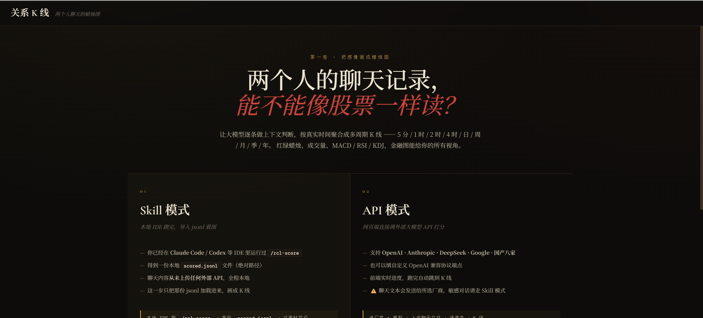
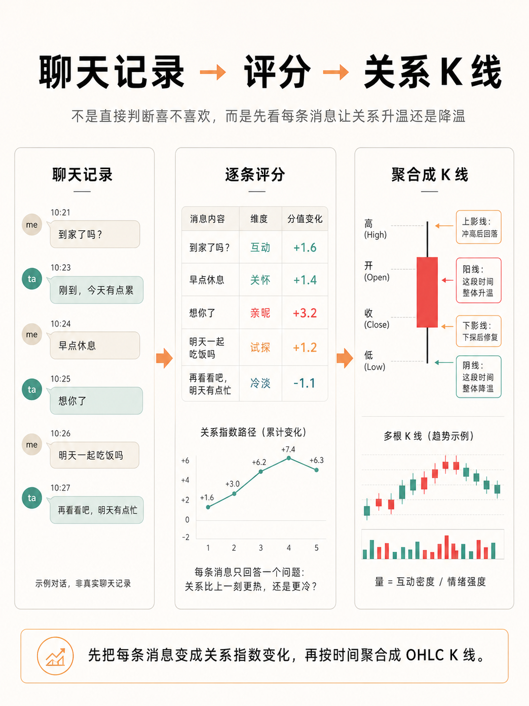
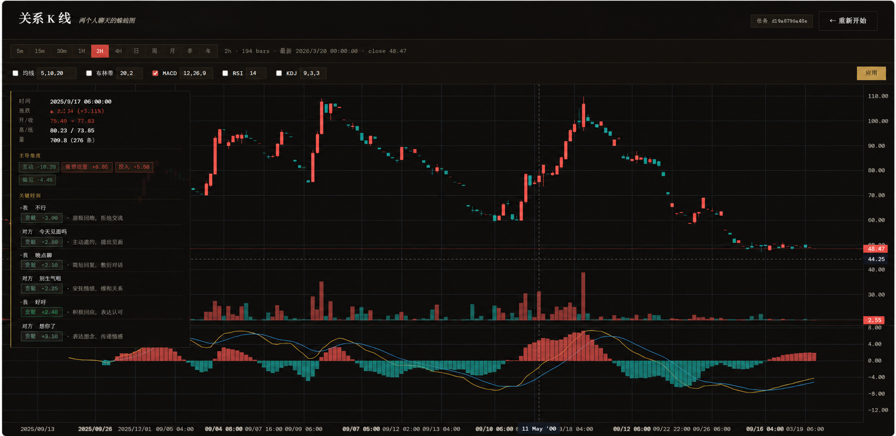
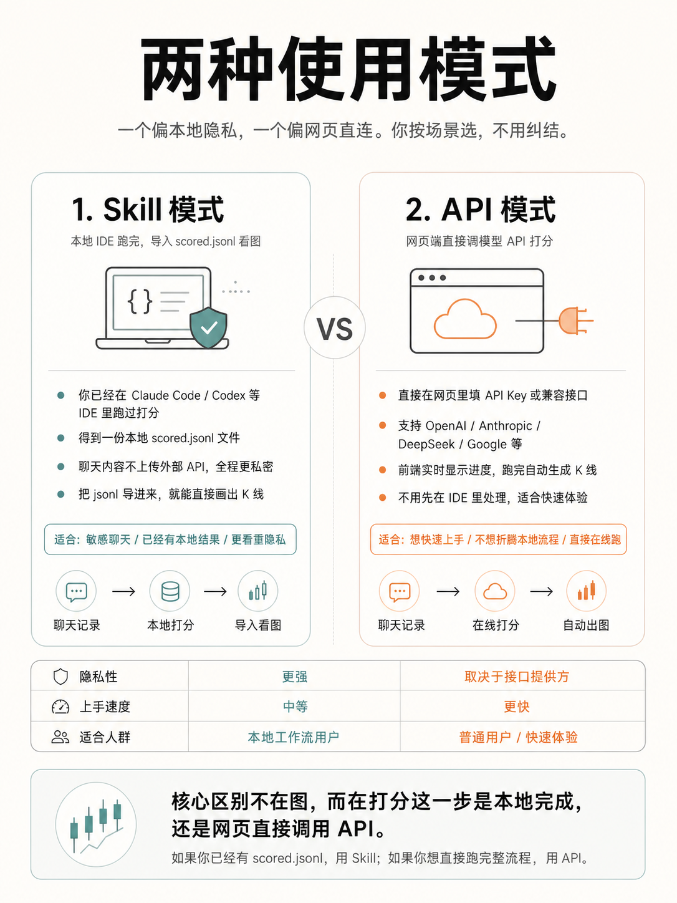

<p align="center">
  
</p>

<h1 align="center">关系烛台实验室 · Relationship Candlestick Lab</h1>

<p align="center"><i>把聊天记录画成 K 线图，看互动变化，也看群聊协作的节奏</i></p>

> 从双人交流到课程项目群，把聊天中的互动变化整理成可回查的 K 线走势图。

**像读股票 K 线一样，回看一段交流的变化。**

## 在线使用

**[打开关系 K 线在线实验室](https://relationship-candlestick-lab-joruno.perfectcube2.chatgpt.site)**

任何拿到链接的人都能在电脑或手机浏览器中打开，无需安装 Python，也不依赖原来的本地文件路径。

- **体验匿名群聊**：直接查看 1,497 条课程群聊样本的 K 线、11 个周期、6 类指标和完整报告，不需要 API Key。
- **分析新的聊天**：上传 CSV、JSON、JSONL 或 TXT，选择群聊协作或双人互动，填写自己的 OpenAI、DeepSeek 或 Anthropic API Key 后逐批分析。
- **换电脑继续**：下载分析进度或评分结果，在另一个浏览器重新导入；失败批次可重试，已完成评分保留。
- **保存结果**：导出 CSV、JSONL、报告，或打印为 PDF。上传内容默认只保留在当前页面内存中，刷新前请下载；API Key 不写入导出文件。

在线版支持最大 10 MB、5,000 条记录，单条文本最多 8,000 字符。AI 分析会把待评分聊天及所需上下文经本站后端发给你选择的服务商，并使用你的模型账户额度。匿名演示不会调用模型。

在线源码独立放在 [`online/`](online/README.md)：前端在 `app/`、接口在 `app/api/analyze/`、计算与模型适配在 `lib/`、公开样本与图表库在 `public/`、回归测试在 `tests/`。本仓库原有 Python 版本和以下完整使用说明继续保留。

```bash
cd online
npm ci
npm run dev
# 验证：npm test && npm run typecheck
# 构建：npm run build
```

支持消息评分、11 种时间周期、技术指标、关键消息归因和历史任务恢复。首页附带我们课程项目群的 **1,497 条匿名化记录演示**，无需 API Key，即可体验从已有评分到图表的完整流程。

> 上方为界面引导图；当前版本增加了群聊测试入口，操作与数据处理说明以本文为准。

> 导入数据时推荐使用 **CSV**；带时间戳的 **JSON / JSONL** 同样支持。若导出文件只有 `role/content` 对话、没有时间戳，就无法生成时间 K 线。详见 [输入格式](#输入格式)。

系统先对聊天记录里的**每一条消息**进行量化：
评分根据前后文识别互动变化：双人场景可以关注关心、投入、冲突与修复；群聊场景可以关注响应、任务协调、支持与共同推进。短回复不必然是冷淡，普通确认也不必然代表升温，判断需要结合所选规则和上下文。

当每条消息都被转化成带时间戳的关系指数后，系统再把这些指数按 5 分钟、1 小时、日线、周线等周期压缩成 K 线蜡烛图：

- **Open**：这个周期开始时的关系指数
- **High**：这个周期内关系最热的时刻
- **Low**：这个周期内关系最冷的时刻
- **Close**：这个周期结束时的关系指数
- **Volume**：消息数量、文字长度和快速回复形成的互动量代理指标

每根 K 线由消息级指数路径按固定规则聚合，开高低收可以复算；作为输入的语义评分仍然包含模型或标注者的判断。
上影线代表关系曾经冲高但回落，下影线代表关系曾经下探但被修复。

<p align="center">
  
</p>

<p align="center"><i>↑ 不是直接判断"喜不喜欢"，而是先看每条消息让关系升温还是降温，再按时间聚合成 OHLC K 线</i></p>

---

## 它能给你什么

- **K 线 + 成交量**：每根 bar 看那段时间的关系强度变化、互动密度
- **MA / EMA / 布林带 / MACD / RSI / KDJ**：技术指标在本机计算；网页工具栏提供 MA、布林带、MACD、RSI、KDJ，EMA 也可通过指标 API 使用
- **每根 K 线的事件归因**：鼠标悬停 → 「这天主要是 *亲昵 +1.4 / 互动 -1.15* 在拉动」+ 4 条最有代表性的关键消息
- **多个时间周期**：5m / 15m / 30m / 1h / 2h / 4h / 日 / 周 / 月 / 季 / 年
- **历史分析记录**：完成的任务保存到本机，服务重启后恢复，浏览器历史可再次打开
- **群聊测试入口**：1,497 条既有标注、5 位匿名成员，点击即可生成完整图表
- **离线图表**：网页图表库随仓库提供；演示脚本还可生成内嵌 Plotly 的独立 HTML
- **可复核输出**：逐消息指数、11 周期 OHLC、消息数量及测试基准
- **稳定导入与续跑**：CSV 编码兼容、JSONL 自动识别、同秒消息保序，以及 API 评分检查点

<p align="center">
  
</p>

<p align="center"><i>↑ 实际效果：悬停某根 K 线时，左侧自动展开归因——主导维度（互动 -10.20 / 投入 +5.50）+ 那段时间的关键消息</i></p>

---

## 体验我们的群聊测试

在首页点击 **“体验我们的群聊测试”**，即可导入仓库附带的已评分样本。无需 API Key，也不会重新调用模型。

样本来自创业课程项目群截至 **2026 年 11 月 18 日 00:01:04（UTC+08:00）**的 1,497 条记录。公开版本保留时间顺序、多成员结构和既有评分；成员使用匿名编号，消息正文与评分理由使用替代文本。它用于复现计算结果，**不能用于复核原始对话语义或重新评估模型评分质量**。文字长度已改变，因此互动量代理指标也不等于原版。详见 [群聊样本说明](examples/group_chat/README.md)。

也可以用命令生成本地演示结果：

```bash
python scripts/run_group_demo.py
```

脚本在 `output/group_demo/` 生成 `relationship_chart.html`、11 种周期的 CSV 和结果汇总，同时保存可由网页打开的任务，并打印对应链接。生成结果保存在 `output/`，不纳入版本控制。


### 群聊样本包含什么

| 项目 | 本次快照 |
|---|---|
| 时间范围 | 2026-09-10 15:03:47 至 2026-11-18 00:01:04，UTC+08:00 |
| 记录总数 | 1,497 条；5 位成员，另有系统记录 |
| 记录类型 | 1,276 条文字或引用回复、200 条媒体或动作、21 条系统通知 |
| 最新指数 | 83.4186；网页显示约 83.42 |
| 日线 / 周线 / 小时线 | 33 / 9 / 103 根有消息的 K 线 |
| 基准文件 | `expected_index.csv`、`expected_ohlc.json`、`manifest.json` |

群聊示例展示的是**可观察的协作氛围**。指数不是成绩、百分比、个人贡献排名或真实关系测量。样本公开了既有评分的计算路径；所有正文和理由均已替换，不能从占位文本推断成员真实发言。

### 三种查看方式

| 方式 | 操作 | 结果 |
|---|---|---|
| 首页体验 | 启动后点击“体验我们的群聊测试” | 直接打开多周期互动图 |
| 本地文件导入 | 选择“导入本地文件”，填写 `examples/group_chat/scored.jsonl` 的完整路径 | 通过常规导入流程查看同一份样本 |
| 命令行生成 | 运行 `python scripts/run_group_demo.py` | 导出独立 HTML、11 周期 CSV、汇总和可恢复任务 |

默认评分提示词面向双人关系。我们的群聊样本使用协作场景的既有标注；给新的群聊重新评分时，应先确定相应维度与规则，不能直接把恋爱维度套用到团队分工。

---

## 准备工作：先导出你的微信聊天记录

分析自己的记录时，先准备**含时间、发送者和正文的聊天导出文件**。双人对话可以直接使用兼容导出格式；群聊应导出或转换为保留每位成员身份的标准字段，再匿名化。已有本地导出文件即可继续，不需要为了体验示例重新导出。

可参考以下开源导出工具；兼容性与导出方式以各项目说明为准：

| 工具 | Stars（参考资料快照，非实时） | 技术栈 | 描述 |
|---|---|---|---|
| [**WeFlow**](https://github.com/hicccc77/WeFlow) | 9.1k | TypeScript / Electron | 本地微信聊天记录导出 + 年度报告应用，桌面 GUI |
| [**WeChatDataAnalysis**](https://github.com/LifeArchiveProject/WeChatDataAnalysis) | 1.1k | Python | 微信 4.x 数据解密、高仿微信界面，支持导出聊天记录、朋友圈、年度总结等 |

> 导出后先检查是否存在完整的**发送者 / 时间戳 / 消息内容**。部分工具的 JSON 导出面向 LLM 微调，不包含时间戳；遇到这种格式，请改导 CSV，或选择带时间戳的 JSON 导出。不要凭空补造时间。

> 其他可用工具：pywxdump、Memotrace 等。**能产出标准聊天记录表的工具都可以作为数据来源**——只要列里有发送者、时间戳、消息内容三样。

导出完拿到一个聊天文件就行，后面的所有步骤都基于这个文件。

**不是微信也能用**：iMessage / Telegram / Discord DM / Instagram DM 等，只要能转换为同样的时间、发送者和正文结构，也可以解析（详见 [输入格式](#输入格式)）。不同平台的附件、引用和系统事件需要单独核对；本项目没有在网页内集成微信一键抓取。

群聊请优先使用标准 `timestamp,sender,message` 格式。部分双人微信专用适配器会把发送方归为 `me/them`，不能用这种映射代替多成员身份。

---

<a id="快速开始"></a>

## 一键启动

下载仓库并安装依赖后，在项目根目录执行 `python start.py`；Windows 也可以双击 `启动关系K线.cmd`。脚本检查必需依赖、按提示补装缺失项、启动后端并自动打开浏览器。按 `Ctrl+C` 停止服务。

### 如果你想手动控制每一步

需要 **Python 3.10+**。请使用源码目录运行：

```bash
git clone https://github.com/Joruno-c/Relationship-Candlestick-Lab.git
cd Relationship-Candlestick-Lab
python -m venv .venv
```

激活虚拟环境：

```powershell
# Windows PowerShell
.\.venv\Scripts\Activate.ps1
```

```bash
# macOS / Linux
source .venv/bin/activate
```

安装依赖并启动：

```bash
python -m pip install -e ".[test]"
python start.py
```

浏览器打开 [http://127.0.0.1:7000](http://127.0.0.1:7000)。也可手动启动服务：

```bash
python -m relationship_candlestick.cli serve --host 127.0.0.1 --port 7000
```

首次安装 Python 依赖需要联网。安装完成后，群聊样本导入、指数计算和图表渲染均可在本机完成；图表库已随仓库提供。当前发布方式是克隆源码加可编辑安装，`frontend/`、`config/` 和 `scripts/` 须与 Python 包一起保留。

没有 Python 时，可从 [python.org/downloads](https://www.python.org/downloads/) 安装。Windows 安装时勾选 *Add Python to PATH*；macOS / Linux 若命令名为 `python3`，将示例中的 `python` 替换为 `python3`。

也可通过 `python -m pip install -r requirements.txt` 安装完整依赖。`anthropic` 和 `openai` SDK 已包含在依赖清单中；使用 API 模式时仍需有效的服务商凭据及网络。群聊演示不调用这些 SDK。

打开网页后可以选择：

| 入口 | 适合谁 | 是否调用模型 |
|---|---|---|
| **体验我们的群聊测试** | 想立即查看完整结果 | 否，重放已有评分 |
| **本地分析（Skills 模式）** | 已在 IDE 或其他流程中得到评分文件 | 网页导入不调用；前期评分取决于工具配置 |
| **在线分析（API 模式）** | 想在网页选择服务商并评分 | 是，文本发往所选服务商 |

---

## 两条工作流

<p align="center">
  
</p>

<p align="center"><i>↑ 两条工作流引导图：先在外部工具评分再导入，或由网页调用模型服务</i></p>

> 图中“全程本地”的描述仅适用于评分也使用本地模型的配置。IDE / Skill 若调用云端模型，相关文本仍会发往模型服务；导入已有评分后的计算和绘图可以离线完成。

### 路线一 · 本地分析（Skills 模式）

先在 IDE / Skill 或其他评分流程中生成文件，再由网页在本机导入。**是否联网取决于前期评分使用的模型和工具配置**；已有评分的导入不需要 API Key。

1. 在支持自定义 Skill 的 IDE / 工具中，按该工具的方式加载本仓库的 `skill/SKILL.md`
2. 使用工具支持的调用方式启动评分流程；`/rcl-score` 是配套说明中的示例名称，实际入口取决于安装配置
3. Skill 会引导你粘聊天文件路径，然后自动跑：拆单字 → 聚合连发 → 逐条评分 → 反扩展回消息级
4. 跑完会给你一份本机评分文件的路径
5. **在仓库目录下跑 `python start.py` 启动网页**
6. 浏览器自动打开后选「导入本地文件」，把刚才的路径粘进去

> 配套规则给出的配置参考包括 Claude Sonnet 4.6 + effort `low`、GPT-5 系列 + effort `low`；实际可用模型及参数以所用服务为准。参考运行记录中 1,000 条消息约需 7 分钟，耗时会随上下文、批量、并发、网络和服务限流变化，不是时限保证。

处理长记录时可先将同一发送者的连续消息聚合成 turn，再扩展回消息级。预处理、API 批量评分、子任务分发和合并命令见 [流水线说明](scripts/README_pipeline.md)。

### 路线二 · 在线分析（API 模式）

让网页端直接调外部模型 API 跑。

1. **在仓库目录下跑 `python start.py` 启动网页**
2. 浏览器自动打开 `http://127.0.0.1:7000`，选「在线分析」
3. 选厂商 + 模型，填 API Key，给聊天文件路径
4. 进度跑完自动跳到 K 线页

网页提供以下厂商配置，也允许填写自定义模型 ID。预置列表不是实时服务目录；可用模型、价格和限制以服务商账户为准：

| 厂商 | 协议 |
|---|---|
| Anthropic（Claude） | Anthropic SDK |
| OpenAI（GPT） · DeepSeek · Google Gemini · xAI（Grok） · Moonshot（Kimi） · 通义千问 · 智谱 GLM · 字节豆包 · 百度文心 ERNIE · 任意 OpenAI 兼容端点 | OpenAI 兼容 |

---

## 输入格式

支持 **CSV / JSON / JSONL / TXT**：

> 推荐 CSV 是为了便于核对列；不是所有 JSON 都不兼容。只有 `{"conversations": [{role, content}]}`、没有时间信息的微调数据无法生成时间 K 线；标准 JSON 与 JSONL 均可自动识别。

- **CSV**（推荐）：微信导出 CSV、pywxdump、Memotrace 等都能识别
- **JSON**：必须**带时间戳**。支持以下形式：
  - 顶层数组：`[{timestamp, sender, message}, ...]`
  - 包壳对象：`{"messages": [...]}` / `{"data": [...]}` / `{"chat": [...]}` 等
  - JSONL（每行一个对象）
  - 字段别名：`ts` / `time` / `StrTime` → timestamp；`from` / `user` / `talker` → sender；`text` / `content` / `StrContent` → message
- **TXT**：每行 `YYYY-MM-DD HH:MM[:SS] sender: message`

`examples/sample_chat.csv`、`sample_chat.json`、`sample_chat.txt` 提供合成格式示例；`examples/group_chat/` 提供我们的群聊 CSV、JSONL 和可直接导入的已评分文件。

### 最小格式示例

下面仅演示文件结构，文字为合成内容：

**CSV**

```csv
timestamp,sender,message
2026-11-17T20:00:00+08:00,Member 01,今晚一起核对展示内容。
2026-11-17T20:01:00+08:00,Member 02,可以，我先检查第二部分。
```

**JSON：数组或包壳对象**

```json
{"messages":[
  {"timestamp":"2026-11-17T20:00:00+08:00","sender":"Member 01","message":"今晚一起核对展示内容。"},
  {"timestamp":"2026-11-17T20:01:00+08:00","sender":"Member 02","message":"可以，我先检查第二部分。"}
]}
```

**JSONL：每行一个完整对象**

```jsonl
{"timestamp":"2026-11-17T20:00:00+08:00","sender":"Member 01","message":"今晚一起核对展示内容。"}
{"timestamp":"2026-11-17T20:01:00+08:00","sender":"Member 02","message":"可以，我先检查第二部分。"}
```

**TXT**

```text
2026-11-17 20:00:00 Member 01: 今晚一起核对展示内容。
2026-11-17 20:01:00 Member 02: 可以，我先检查第二部分。
```

CSV 会尝试 UTF-8（含 BOM）、GB18030 等编码。带时区的时间建议在同一份文件内保持一致；同一秒内的消息保持输入顺序，以免改变后续上下文与数值路径。JSONL 可通过 `.jsonl` 后缀自动识别。

聊天输入与评分文件用途不同：`messages.*` 是待解析记录；`scored.jsonl` 还包含已有 delta 等评分字段。仅有聊天正文不能直接作为已评分文件导入。

---

## 项目结构

```text
Relationship-Candlestick-Lab/
├── .github/workflows/tests.yml     # Windows / Ubuntu 自动测试
├── config/default_weights.yaml    # 数值参数和互动量权重
├── docs/                          # 四张引导图和参考文档归档
│   ├── preview.png                # 首页引导图
│   ├── pipeline.png               # 消息 → 评分 → K线
│   ├── showcase.png               # 图表效果与归因
│   ├── two-modes.png              # 两种评分工作流
│   └── upstream/                  # 完整历史文档、插图与许可
├── examples/
│   ├── group_chat/                # 我们的1497条群聊数值样本与基准
│   └── sample_chat.*              # CSV / JSON / TXT 合成格式示例
├── frontend/                      # 网页单页应用
│   └── vendor/                    # 本地图表库及第三方许可
├── relationship_candlestick/
│   ├── pipeline.py                # 预处理、评分与消息级反扩展
│   ├── server.py                  # FastAPI 网页与群聊演示入口
│   ├── job_store.py               # 任务保存与重启恢复
│   ├── ohlc.py                    # K线聚合、维度归因和关键消息
│   ├── indicators.py              # MA / EMA / BOLL / MACD / RSI / KDJ
│   ├── parser.py                  # CSV / JSON / JSONL / TXT 解析
│   ├── ai_scorer.py               # 评分文件加载与指数递推
│   ├── volume.py                  # 互动量代理指标
│   └── cli.py                     # 命令行入口
├── scripts/                       # 数据流水线、批量处理与格式转换
│   └── run_group_demo.py          # 无需API的群聊演示
├── skill/SKILL.md                 # 双人场景v3.1评分规则与示例
├── tests/                         # 64项解析、计算、群聊和恢复测试
├── .gitattributes                 # 换行规则与样本校验一致性
├── .gitignore                     # 忽略密钥、缓存、私人文件与输出
├── ARCHITECTURE.md                # 架构与实现说明
├── LICENSE
├── pyproject.toml
├── requirements.txt
├── 启动关系K线.cmd
└── start.py
```

`output/` 由运行过程创建，用来保存结果和任务；`.venv/` 为本机 Python 环境。它们与私人聊天导出、密钥、临时文件一起排除在仓库外。公开测试数据统一放在 `examples/group_chat/`。

---

## 评分规则（v3.1）

以下十维度与尺度说明对应默认双人场景。它们是标注约定，不是经过客观测量的人际关系量表；群聊样本的协作维度另列在本节后部。

### 核心思想：相对评分，不是绝对评分

LLM **不**打"这条消息亲昵度 = 5"这种绝对分（因为没有客观锚点）。
它给每条消息**两个相对 delta**：

- `delta_vs_prior` — 比**紧挨着的上一条**消息暖了 / 冷了多少
- `delta_vs_atmosphere` — 比**最近 20 条的整体氛围**暖了 / 冷了多少

这种设计把判断问题落在相邻消息和近期上下文的相对变化上，减少对绝对分值的依赖。不同模型、上下文或标注者仍可能给出不同结果，因此应结合理由和原文回查。

### 10 个语义维度

除了两个 delta，每条消息还要标一个**主导维度**——是哪个轴在拉动这条消息：

| 维度 | 含义 | 推涨示例 | 推跌示例 |
|---|---|---|---|
| **affection** | 情感温度 | 宝宝 / 想你 / 晚安宝贝 | 单字"哦/嗯" / 呵呵 / 无所谓 |
| **engagement** | 互动投入 | 长回复 / 主动延展 / 秒回 | 敷衍短回 / 转移话题 / 拖延 |
| **care** | 关心 | 关心身体 / 记得对方细节 | 漠视处境 / 嘲讽状态 |
| **conflict** | 冲突（双向）| 道歉 / 示弱 / 让步（修复）| 阴阳 / 翻旧账 / 冷战（攻击）|
| **tension** | 暧昧张力 | 试探 / 吃醋 / 打闹 | 明确划界 / 拒推进 |
| **investment** | 关系投入 | 主动约 / 锁时间地点 / 送礼 | 拒邀约 / 取消计划 / 找借口 |
| **awkwardness** | 默契度（反向）| 接梗 / 共笑 / 流畅来回 | 尬聊 / 答非所问 / 突兀转场 |
| **future_orientation** | 未来导向 | "等寒假回来" / "以后" | "先到这吧" / 拒谈未来 |
| **vulnerability** | 暴露脆弱 | 分享秘密 / 感情史 / 弱点 | 回避深入 / 筑墙 |
| **shared_identity** | 内圈语言 | 用昵称 / 用内梗 / "我们" | 刻意外圈称呼 |

> 注意：维度只用于**展示和归因**（鼠标悬停一根 K 线时显示"这天主要是 *亲昵 +1.4* 在拉动"），**不进入数学计算**。真正驱动 K 线的是两个 delta。

### 评分尺度（每条消息都在动指针）

默认双人评分规则以 **±0.2 ~ ±0.5 的小幅变化**作为微波动参考，并给出更强事件的尺度。下面的频率是规则中的设计参考，不是对真实聊天总体的统计结论。emoji、短回复或“嗯/哈哈”的含义都依赖上下文；没有足够证据时可以为零，不能为制造影线强行增减。

| Delta 量级 | 含义 | 默认规则的频率参考（非统计结论） |
|---|---|---|
| **±0.2 ~ ±0.5** | 微波动——自然起伏 | **大多数消息都在这** |
| ±0.5 ~ ±1.5 | 轻微但能感知的变化 | ~25% |
| ±2 ~ ±4 | 明显能注意到的变化 | ~10% |
| ±5 ~ ±8 | 大动作（试探 / 邀约 / 修复 / 冲突）| ~3% |
| ±9 ~ ±15 | 罕见标志事件（告白 / 分手）| < 1% |
| `0, 0` | 真的完全不动——少用 | < 15% |

正是这些微波动让 K 线长出**影线**：上影 = 那段曾经冲高但回落，下影 = 那段曾经下探但被修复。
若所有 delta 为零，指数只受时间回归规则影响；从基线 50 开始时会保持平直。从非基线开始时仍会向 50 回归。是否产生波动应服从证据，而不是图表外观。

### 框架做的事：时间衰减 + OHLC 聚合

每条消息打完分后，本地 Python 框架按下面的公式递推关系指数：

```
gap_hours   = 距上条消息的真实时长
decay       = 1 - exp(-gap_hours / 72)              # 72 小时时间常数
delta_blend = 0.5 × delta_vs_prior + 0.5 × delta_vs_atmosphere

index_t = prev_index × (1 - decay) + 50 × decay + delta_blend
```

含义：

- **混合两个参考帧**：`vs_prior` 和 `vs_atmosphere` 各占一半，避免单一视角偏差
- **时间衰减**：长时间不聊，关系指数自动往 50 基线回归——LLM 不用手动惩罚"长时间没说话"
- **不夹紧**：v3 指数可以突破 100，也可以跌破 0；数值不是百分比
- **时间含义**：72 小时是时间常数，半衰期约为 49.9 小时；长时间不发消息的回落不等于关系恶化

之后按你选的周期（5m / 1h / 日 / 周 / 月 …）把消息级指数压成 OHLC：

| | 含义 |
|---|---|
| **Open** | 周期开始时的关系指数 |
| **High** | 周期内的最高点 |
| **Low** | 周期内的最低点 |
| **Close** | 周期结束时的关系指数 |
| **Volume** | 消息数、字符数和快速回复数的加权和，权重见配置文件 |

默认按有消息的周期展示（`active-only`）；`calendar` 模式可用于补齐空周期。媒体未读取或语音未转写时，不能把其内容当作已知语义。

完整规则、Worked examples（密集 flirt 段、冷战段、单条事件三类示例打分）、边界情况见 [`skill/SKILL.md`](skill/SKILL.md)。架构和评分流水线见 [`ARCHITECTURE.md`](ARCHITECTURE.md)。

---

### 我们的群聊使用哪些协作维度

| 类别 | 观察内容 | 解读边界 |
|---|---|---|
| `engagement` 互动 | 对任务讨论的回应与持续参与 | 短消息不自动等于敷衍 |
| `investment` 投入 | 承担工作、补充材料和行动承诺 | 承诺不证明任务已经完成 |
| `coordination` 协调 | 分工、时间安排、共同计划 | 约定不证明活动已经举行 |
| `support` 支持 | 体谅、帮助和回应困难 | 不推断成员真实心理状态 |
| `repair` 修复 | 澄清分歧、调整方案和修复沟通 | 区分任务压力与人际冲突 |
| `shared_identity` 团队认同 | 共同目标和群体协作语言 | 不用于评价个人贡献 |
| `unassessed_media` / `system` | 未评估媒体及系统通知 | 标记记录类型，不推断未读取内容 |

群聊样本保留既有 delta，并把文本和理由替换为占位符。这里可以验证数值重现，不能验证模型是否正确理解原句。普通确认、未读取媒体和系统通知允许保持零变化。

---

## 命令行与批量处理

以下命令在仓库根目录运行：

```bash
# 将公开群聊样本解析为标准消息文件
python -m relationship_candlestick.cli prepare --input examples/group_chat/messages.csv --output output/messages.jsonl

# 从已有评分生成全部周期、图表和报告，无需模型API
python -m relationship_candlestick.cli ingest --scored examples/group_chat/scored.jsonl --all-timeframes --output output/group_cli

# 生成群聊专用离线演示，并保存网页可恢复任务
python scripts/run_group_demo.py
```

API 流水线支持按批评分、并发、超时设置和已有检查点续跑。相同输入与影响评分的参数会用于生成稳定任务 ID；更换 API Key 不应改变已完成评分。任务记录与中间文件位于 `output/_jobs/`。详细脚本参数见 [流水线说明](scripts/README_pipeline.md)，实现与持久化机制见 [架构说明](ARCHITECTURE.md)。

## 运行测试

```bash
python -m pip install -e ".[test]"
python -m pytest -q

# 只运行我们的群聊回归与网页API测试
python -m pytest tests/test_group_chat.py tests/test_group_demo_api.py -q
```

当前共有 **64 项自动测试**，其中 **16 项**覆盖群聊解析、逐条指数、11 周期聚合、公开字段、网页 API 与恢复流程。所有测试使用现成数据，不需要模型账号或 API Key。

| 验证项 | 内容 |
|---|---|
| 解析 | CSV、JSON / JSONL、TXT、编码兼容、同秒顺序 |
| 评分数值 | v2 / v3加载、全部1,497条群聊指数 |
| K线 | 11周期每根OHLC与消息数、开高低收边界 |
| 任务恢复 | 完成任务落盘、重启恢复、API响应一致性 |
| 样本内容 | 字段白名单、固定占位正文、匿名发送者和校验值 |
| 跨平台 | GitHub Actions：Ubuntu / Windows × Python 3.10 / 3.12 |

查看 [自动测试记录](https://github.com/Joruno-c/Relationship-Candlestick-Lab/actions/workflows/tests.yml)。这些测试检验程序行为和数值重现，不证明语义评分客观正确。

## 常见问题

| 问题 | 处理方法 |
|---|---|
| 只想先看图，不想配置模型 | 点击首页“体验我们的群聊测试” |
| JSON 提示没有时间戳 | 检查是否为只有role/content的微调格式，重新导出带时间的CSV或JSON |
| CSV中文乱码 | 优先导出UTF-8；解析器也支持GB18030等编码 |
| 导入目录提示有多个候选文件 | 填写具体文件完整路径；路径含空格时终端参数加引号 |
| 群成员被合并为同一个发送者 | 使用保留真实成员列的标准CSV/JSONL，再匿名化；不要套用双人me/them导出结构 |
| 重启后想打开历史结果 | 从浏览器历史分析进入；完成快照保存在output/_jobs中 |
| 更换电脑后旧任务链接打不开 | 新电脑需要对应的任务快照；公开样本可直接重新点击演示，私人快照由自己保存 |
| 没有网络能否看图 | 安装依赖后，已有评分导入和图表可离线使用；新API评分仍需联网 |
| 长周期没有某条指标 | 检查该周期的K线数量是否达到指标窗口长度 |
| 指数是否就是关系好坏百分比 | 不是；它只是标注与递推规则的输出，不能用于成绩或贡献排名 |

## 隐私

- **本地导入**：已有评分的加载、聚合和绘图在本机完成
- **IDE / Skill 评分**：使用云端模型时文本仍会发往服务商；只有采用本地模型等适当配置时评分才可全程离线
- **在线分析**：聊天文本发送给所选厂商，应先确认数据内容与服务设置
- API Key 只在浏览器本会话使用，**不写入** localStorage
- 表单不会持久保存聊天路径；**历史记录可能保存本机文件路径**，共享电脑上需注意浏览器记录
- `.gitignore` 默认排除 `output/`，分析结果不会被误推到仓库
- 应用本身未设置遥测上报；网页图表库已本地打包，字体使用本机字体栈
- 完成任务的 `output/_jobs/` 快照可能含导入的聊天内容，文件应由自己保管
- 公开群聊样本不包含姓名映射、正文原文、原评分理由、附件、学号、账号或密钥；保留时间戳与数值轨迹
- 本服务默认监听 `127.0.0.1`，面向单人本机使用

---

## 它**不**能干的事

- 不预测对方真实想法、不预测关系结果
- 不做"TA 喜不喜欢你"这种主观判断
- 它只整理聊天里可观察的信号，给一个可回查的走势图
- 不证明成员说过的事实、任务完成情况、展示质量或活动是否举行
- 不从未读取的图片、附件、语音中推断内容，也不自动抓取未来群消息
- 不替代团队讨论，不用于个人能力、贡献或心理状态评估

如果你想用它来做决定，请先意识到这只是一种**事后视角的可视化**。

---

## License

MIT — 详见 [`LICENSE`](LICENSE)。
图表库 lightweight-charts 是 Apache 2.0，附带 [LICENSE](frontend/vendor/LICENSE-lightweight-charts.txt) 和 [NOTICE](frontend/vendor/NOTICE-lightweight-charts.txt)。版权声明与许可保留在相应文件中；完整参考文档另存于 [docs/upstream/](docs/upstream/README.md)。
